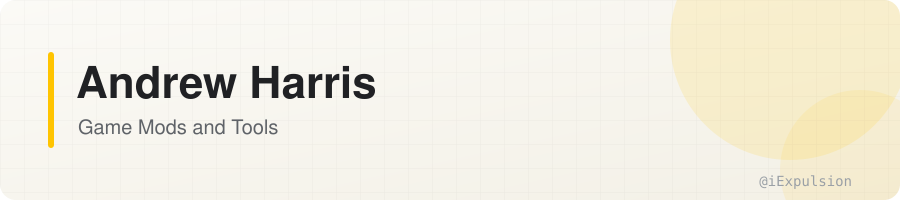
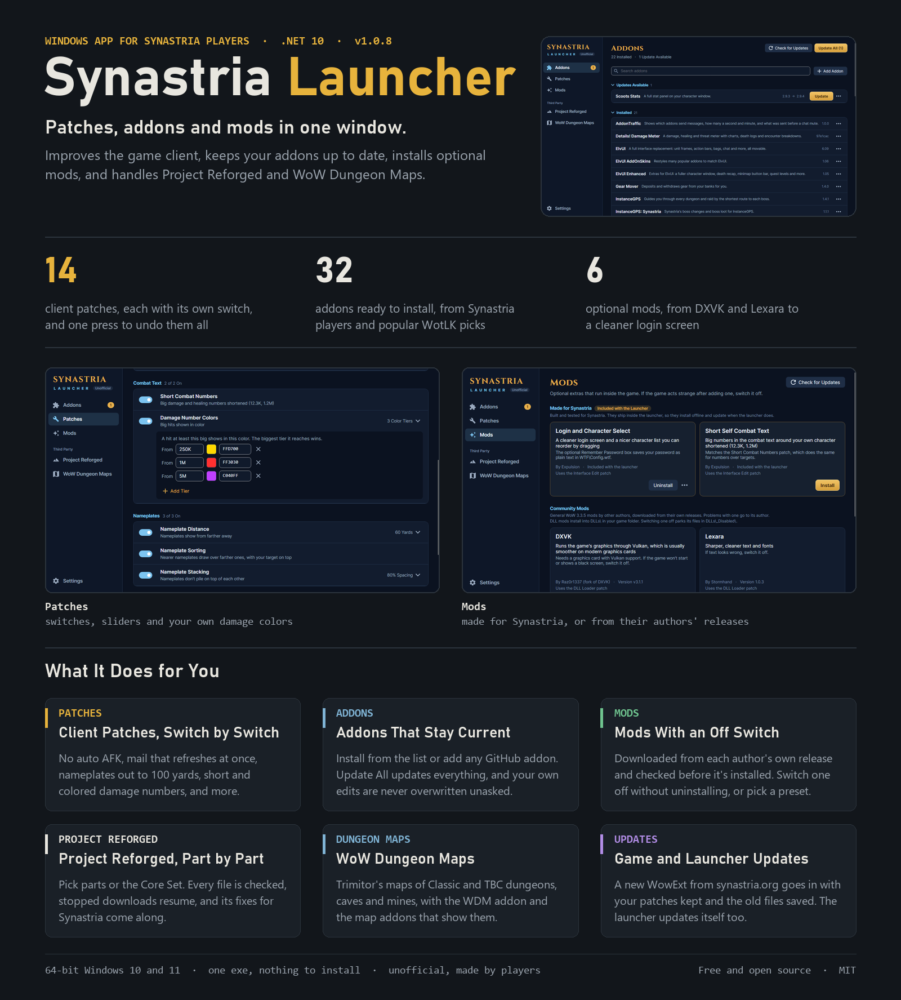
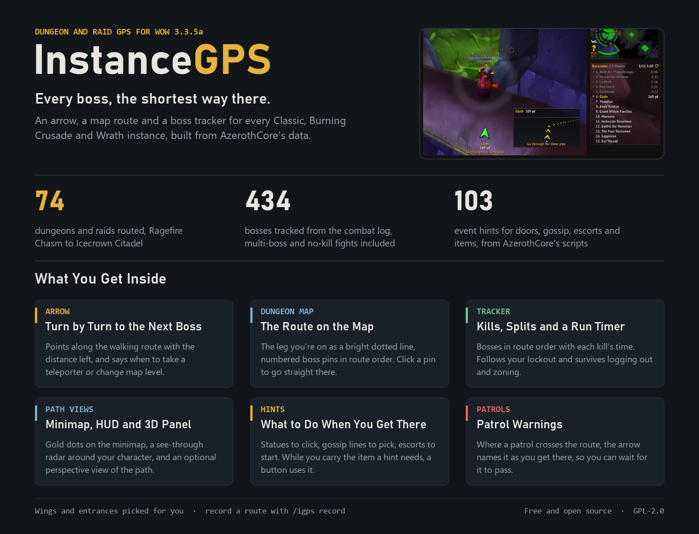
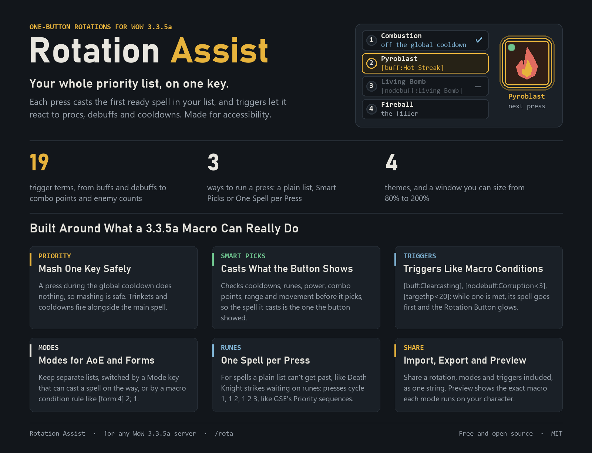
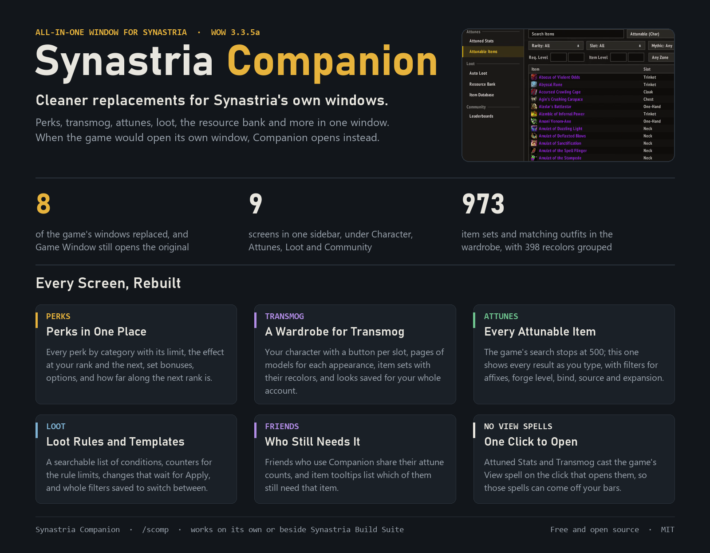
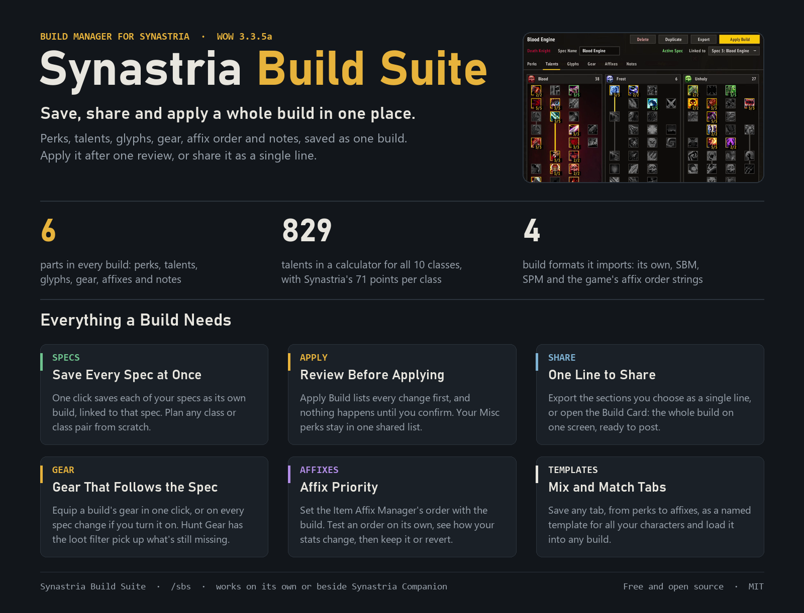
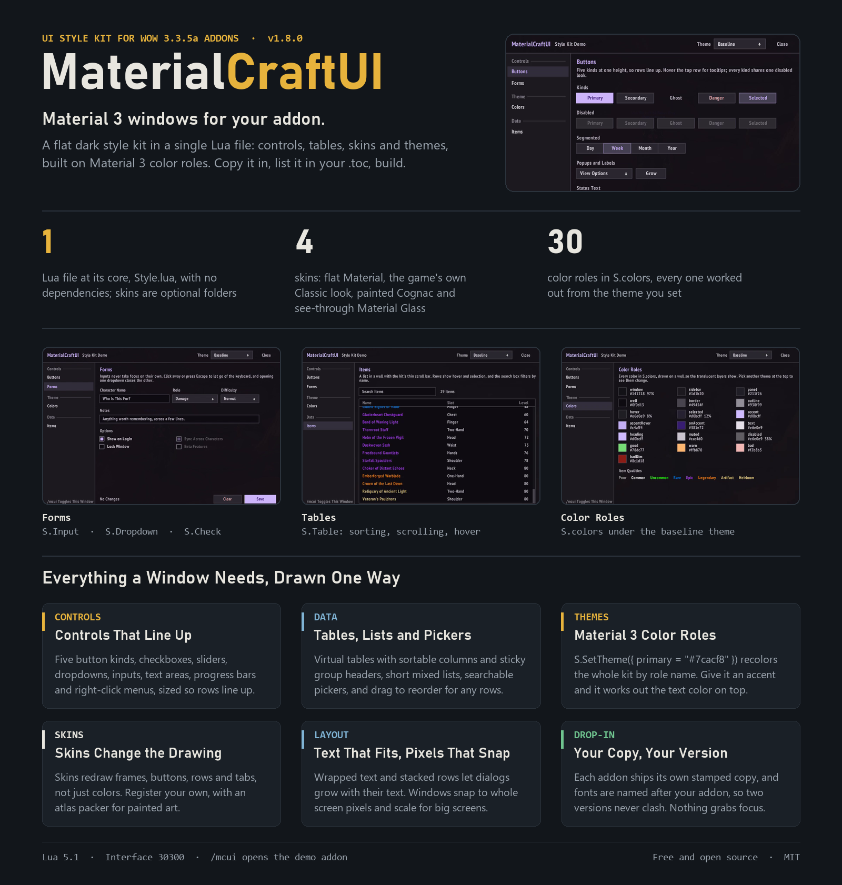

<picture>
  <source media="(prefers-color-scheme: dark)" srcset="assets/header-dark.svg">
  
</picture>

I'm a software developer working mainly in C# and .NET, with Lua and Python alongside. My public work is tooling for games: World of Warcraft 3.3.5a addons for private servers built on [AzerothCore](https://github.com/azerothcore/azerothcore-wotlk), a .NET desktop launcher, and C# mods for [Erenshor](https://store.steampowered.com/app/2382520/Erenshor/). I build them end to end: data pipelines, algorithms, UI libraries, automated tests and release CI, with documentation written for the people who use them.

        

## Highlights

### [Synastria Launcher](https://github.com/iExpulsion/SynastriaLauncher)

A desktop launcher that patches the game client, keeps addons up to date and installs optional mods from one window.

- .NET 10 and Avalonia 12, shipped as one self-contained, trimmed exe, with the logic in a UI-free core library.
- Client patches load at startup through a small native DLL that CI compiles alongside the app, so every change can be switched off and undone.
- xUnit tests, including parity tests that run the older PowerShell patcher it replaced and compare the results.

### [InstanceGPS](https://github.com/iExpulsion/InstanceGPS)

A dungeon and raid GPS: an arrow, a map route and a boss tracker for every Classic, TBC and Wrath instance.

- A Python build pipeline turns the client's DBC files and AzerothCore's world database into the addon's data.
- Walking routes come from the server's own navigation mesh, with teleporter unlocks, heroic-only bosses and faction differences modeled from its scripts ([how the routes are made](https://github.com/iExpulsion/InstanceGPS/blob/main/docs/ROUTES.md)).
- A documented module API lets a server's differences live in a separate addon, like [InstanceGPS-Synastria](https://github.com/iExpulsion/InstanceGPS-Synastria).

### [Rotation Assist](https://github.com/iExpulsion/RotationAssist)

One-button rotations: priority lists with triggers, modes and an on-screen Rotation Button.

- Works inside the game's secure action rules, which block addons from choosing spells in combat directly.
- Tested outside the game with a Lua harness that mocks the client API; CI syntax-checks and packages each release.
- Server-specific classes and spells come from a module, [RotationAssist-Synastria](https://github.com/iExpulsion/RotationAssist-Synastria).

### [Synastria Companion](https://github.com/iExpulsion/SynastriaCompanion) and [Synastria Build Suite](https://github.com/iExpulsion/SynastriaBuildSuite)

<table>
  <tr>
    <td width="50%"></td>
    <td width="50%"></td>
  </tr>
</table>

Companion replaces the server's own windows with one consistent window; Build Suite saves, shares and applies character builds.

- Companion shares attune progress with friends over a paced message queue that stays well under the server's chat rate limit.
- Build Suite imports the community's existing build formats and exports its own versioned share strings.
- The two work alone or together through a small, documented API, never each other's internals.

### [MaterialCraftUI](https://github.com/iExpulsion/MaterialCraftUI)

The UI library behind every addon above: a flat style kit on Material 3 color roles, in one file.

- Themes, swappable skins, tables, lists, pickers and window scaling, shared by vendoring a stamped copy into each addon so every addon ships the exact version it was tested with.
- Its own test suite and tagged releases with a changelog.

## Erenshor Mods

Earlier BepInEx plugins for [Erenshor](https://store.steampowered.com/app/2382520/Erenshor/), written in C# with Harmony patches. These are kept for source reference; my newer mods are on [Erenshor Vault](https://erenshorvault.app/).

| Mod | What It Does |
| --- | --- |
| [WikiMap](https://github.com/iExpulsion/Expulsion.Erenshor.WikiMap) | Replaces the in-game map with the Erenshor Wiki's, showing zone levels and routes. |
| [ZoneInfo](https://github.com/iExpulsion/Expulsion.Erenshor.ZoneInfo) | Shows a zone's level range alongside its name when you enter it. |
| [VendorInfo](https://github.com/iExpulsion/Expulsion.Erenshor.VendorInfo) | Shows sell and purchase prices when you hover over an item. |
| [Wellstone](https://github.com/iExpulsion/Expulsion.Erenshor.Wellstone) | Adds a spell that teleports you to your last Wishing Well. |
| [SpellSkillCleanupFix](https://github.com/iExpulsion/Expulsion.Erenshor.SpellSkillCleanupFix) | Removes invalid spell and skill IDs from a save before it loads, so removing a spell mod can't break a character. |
