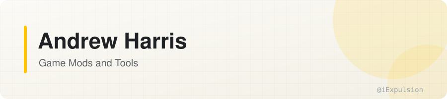

<picture>
  <source media="(prefers-color-scheme: dark)" srcset="assets/header-dark.svg">
  
</picture>

I build mods and tools for the games I play: currently World of Warcraft 3.3.5a private servers built on [AzerothCore](https://github.com/azerothcore/azerothcore-wotlk), such as Synastria, and [Erenshor](https://store.steampowered.com/app/2382520/Erenshor/).

## Featured

<table>
  <tr>
    <td width="55%">
      
    </td>
    <td width="45%" valign="top">
      <h3><a href="https://github.com/iExpulsion/InstanceGPS">InstanceGPS</a></h3>
      
      
      
A dungeon and raid GPS. It takes you through every Classic, TBC and Wrath instance along the shortest route that visits every boss, tracks your kills and times your run.

      
➕ <a href="https://github.com/iExpulsion/InstanceGPS-Synastria">Synastria Module</a>: Boss Loot and Attunement Tracking

    </td>
  </tr>
  <tr>
    <td width="45%" valign="top">
      <h3><a href="https://github.com/iExpulsion/RotationAssist">Rotation Assist</a></h3>
      
      
      
One-button rotations: priority lists, triggers, modes and an on-screen Rotation Button.

      
➕ <a href="https://github.com/iExpulsion/RotationAssist-Synastria">Synastria Module</a>: Both of Synastria's Classes

    </td>
    <td width="55%">
      
    </td>
  </tr>
  <tr>
    <td width="55%">
      
    </td>
    <td width="45%" valign="top">
      <h3><a href="https://github.com/iExpulsion/SynastriaCompanion">Synastria Companion</a></h3>
      
      
      
Cleaner replacements for Synastria's own windows: Attuned Stats, Attunable Items, Auto Loot, the Resource Bank, the Item Database and Leaderboards.

    </td>
  </tr>
  <tr>
    <td width="45%" valign="top">
      <h3><a href="https://github.com/iExpulsion/SynastriaBuildSuite">Synastria Build Suite</a></h3>
      
      
      
Save, share and apply builds: Perks, Talents, Glyphs, Gear and Affix Priority.

    </td>
    <td width="55%">
      
    </td>
  </tr>
  <tr>
    <td width="55%">
      
    </td>
    <td width="45%" valign="top">
      <h3><a href="https://github.com/iExpulsion/MaterialCraftUI">MaterialCraftUI</a></h3>
      
      
      
A flat dark style kit for addon developers, built on Material 3 color roles: themes, buttons, checkboxes, dropdowns and inputs in one file.

    </td>
  </tr>
</table>

## Erenshor Mods

BepInEx plugins for [Erenshor](https://store.steampowered.com/app/2382520/Erenshor/), written in C#. These are kept for source reference; my newer mods are on [Erenshor Vault](https://erenshorvault.app/).

| Mod | What It Does |
| --- | --- |
| [WikiMap](https://github.com/iExpulsion/Expulsion.Erenshor.WikiMap) | Replaces the in-game map with the Erenshor Wiki's, showing zone levels and routes. |
| [ZoneInfo](https://github.com/iExpulsion/Expulsion.Erenshor.ZoneInfo) | Shows a zone's level range alongside its name when you enter it. |
| [VendorInfo](https://github.com/iExpulsion/Expulsion.Erenshor.VendorInfo) | Shows sell and purchase prices when you hover over an item. |
| [Wellstone](https://github.com/iExpulsion/Expulsion.Erenshor.Wellstone) | Adds a spell that teleports you to your last Wishing Well. |
| [SpellSkillCleanupFix](https://github.com/iExpulsion/Expulsion.Erenshor.SpellSkillCleanupFix) | Removes invalid spell and skill IDs from a save before it loads, so removing a spell mod can't break a character. |
